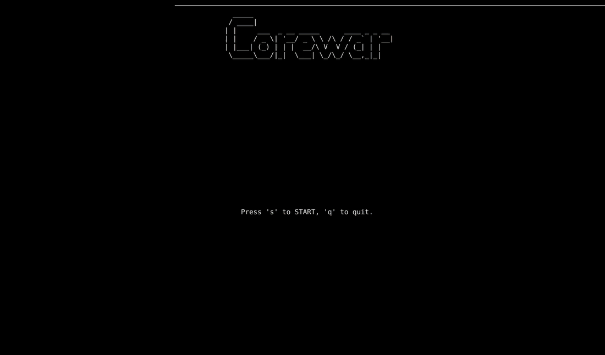

# Corewar

A virtual machine for Corewar, written in C. Compiled champion programs (`.cor` files) are loaded into a shared circular memory of 6 KB and executed cycle by cycle; each champion tries to stay alive by calling `live` while overwriting the others. The last champion with living processes wins; if the last ones die in the same check, the last player reported alive wins. A bonus build shows the arena live in the terminal with ncurses.



**C · ncurses · Criterion · Make**

Epitech project, built in a pair.

The assembler that compiles champions into `.cor` files was a separate project (Robot Factory) and is not part of this repository.

## Features

- Loads any number of champions from `.cor` files: checks the magic number, reads the name, comment, program size and code.
- `-n` sets a champion's number and `-a` its load address; without `-a`, champions are placed as far apart from each other as possible.
- Cycle loop with `CYCLE_TO_DIE` / `CYCLE_DELTA` / `NBR_LIVE` rules: processes that did not report `live` in time are killed.
- All 16 instructions: `live`, `ld`, `st`, `add`, `sub`, `and`, `or`, `xor`, `zjmp`, `ldi`, `sti`, `fork`, `lld`, `lldi`, `lfork`, `aff`.
- `-dump nbr_cycle` prints the memory after that cycle, 32 bytes per line in hexadecimal, coloured by the champion that wrote each byte.
- Announces the winner at the end of the round.
- Bonus ncurses view (`corewar_bonus`): start menu, scrolling arena coloured by owner, adjustable speed and pause. Each process is shown as a highlighted cursor, freshly written bytes glow and fade, a champion's name flashes when it reports `live`, and the side panel shows its living processes and how much memory it owns. The winner is announced over the arena.

## Build & run

Requires `gcc` and `make`; the bonus also needs `ncurses`.

```sh
make            # builds ./corewar
make bonus      # also builds ./corewar_bonus (ncurses view)
make re         # full rebuild
make fclean     # remove objects, libraries and binaries
```

```sh
./corewar -h
./corewar [-dump nbr_cycle] [[-n prog_number] [-a load_address] prog_name] ...
```

Example with the sample champions:

```sh
./corewar -dump 1000 -n 1 test_champions/abel.cor -n 2 test_champions/bill.cor \
          -n 3 test_champions/pdd.cor -n 4 test_champions/tyron.cor
```

The ncurses view takes the same arguments and must be run from the repository root (it reads `bonus/Ncurses/Corewar.txt`):

```sh
./corewar_bonus test_champions/abel.cor test_champions/bill.cor
```

The recording above (sped up 8 times) uses four demo champions from `docs/demo/`, loaded close together so the whole fight fits on one screen. Each one forks into two or three processes that paint windows of memory near its neighbours: Flare falls first, then Tide, then Ivy, and Spark wins at cycle 12202. Colours need a 256-colour terminal; other terminals get the basic palette.

```sh
./corewar_bonus -n 1 -a 0 docs/demo/spark.cor -n 2 -a 400 docs/demo/ivy.cor \
                -n 3 -a 800 docs/demo/flare.cor -n 4 -a 1200 docs/demo/tide.cor
```

Controls: `s` start, `Space` pause/resume, `Left`/`Right` change the delay by 10 ms, `Up`/`Down` scroll the arena, `q` quit.

Unit tests use Criterion: `make unit_tests` builds `tests/unit_tests`, to run from the repository root. They cover champion loading, every instruction that takes arguments, negative offsets, `fork`, the winner and the options.

## Project layout

- `corewar.c` - entry point: argument check, usage, setup and run.
- `Project_Functions/` - the virtual machine: parsing, initialization, processes, the cycle loop and one file per instruction.
- `Basic_Functions/` - small C utility library (strings, parsing, printing, conversions), built as `libmy.a`.
- `bonus/` - ncurses front end and its own entry point.
- `include/` - headers, including `op.h` with the VM constants and instruction table.
- `test_champions/` - sample champions, as source (`.s`) and compiled (`.cor`).
- `docs/demo/` - the four champions used in the recording, as source and compiled.
- `tests/` - Criterion unit tests.

## After the project

Once the project was graded, the virtual machine was corrected: jumps, forks and stores now use signed offsets relative to the instruction, indirect arguments are read from memory, `and`/`or`/`xor` decode their arguments correctly, `-n` and `-a` work without `-dump`, and the last player reported alive wins when everyone dies at once. Criterion tests cover each fix. The ncurses view was reworked at the same time for the recording above.

## Team and contributions

Kevin Huynh ([@Nivek-Hyn](https://github.com/Nivek-Hyn)) and Hatim Ouaadi.

- Kevin Huynh: the virtual machine (loading champions, the cycle loop, every instruction, the live checks) and the ncurses view.
